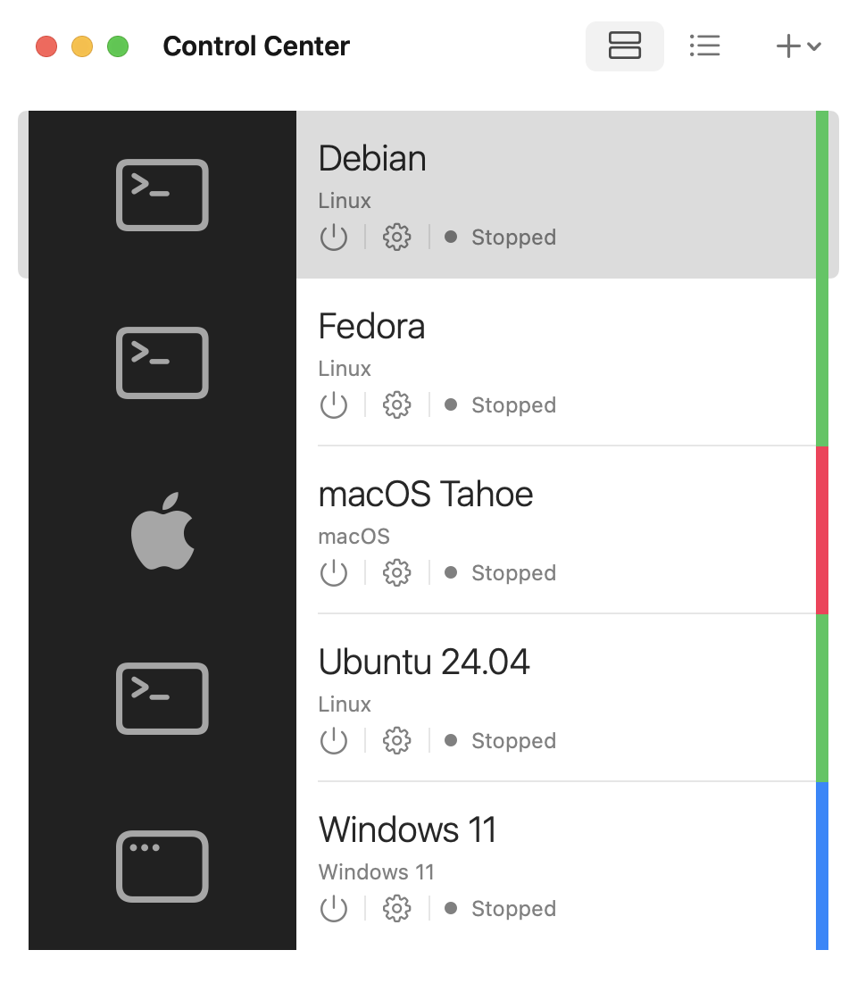

# Tandem

Windows, Linux and macOS virtual machines on Apple silicon Macs, in a native app. Free and open source (Apache-2.0).

Tandem is **early software**: the day-to-day flows work for its author, but expect rough edges, and read
[Status](#status) before trusting it with VMs you cannot recreate. It is not affiliated with Parallels, Apple or Microsoft.



## What it does

- **Install a system without hunting for ISOs.** Create New offers free systems to download and install unattended:
  Windows 11 ARM (Microsoft's own media), macOS (Apple's restore images), Ubuntu (MATE, Xfce or GNOME desktop, or Server),
  Debian, Fedora and Kali. You answer one page (name, account); Tandem does the rest.
  
- **Two engines.** macOS guests run on Apple's Virtualization framework. Windows runs on QEMU with Apple's Hypervisor
  framework; Linux can use either (QEMU for a TPM, USB redirection or 3D).
- **Guest tools**: shared clipboard, shared Mac folders, drag and drop, resolution that follows the window, clean
  shutdown, time sync, and **Seamless mode** (Windows programs in Mac windows, launchable from Finder and the Dock).
  Not every feature exists on every guest; see [Status](#status).
- **Snapshots, instant clones, suspend and resume.**
- **Sharing profiles and restrictions** for VMs you do not fully trust.
- **USB**: drives and serial adapters can be given to a VM. Full USB pass-through of arbitrary devices needs an Apple
  entitlement that this project does not have yet (see [Status](#status)).
- **3D acceleration (experimental)** for Linux and Windows guests, built from UTM's open-source graphics stack.
- **Automation**: a `tandem` command-line tool and an MCP server, so scripts and AI tools can start, snapshot and run commands
  in VMs, with switches and per-VM permissions that you control.
- **Import** existing Parallels Desktop VMs that you own.
- **Self-contained app** with its own QEMU, signed updates, uninstaller and crash-report prompts that send nothing without your say.

More screenshots are in [`screenshots/`](screenshots/).

## Status

| Area | State |
|---|---|
| Linux, Windows 11 ARM, macOS guests: install, run, snapshots, clone | Working |
| Guest tools: Windows and Linux | Working; macOS guest tools are new and lightly tested |
| Seamless mode (Windows) | Working; some drag-out cases unfinished |
| 3D acceleration | Experimental; Windows 3D cannot resize while running |
| USB pass-through | Drives and serial devices only; full pass-through needs Apple's `com.apple.vm.device-access` entitlement |
| Notarised releases and automatic updates | Built; no notarised release yet |
| Linux Seamless mode, printers, camera, other importers | Not started (see `ROADMAP.md`) |

Requirements: Apple silicon Mac, **macOS 15 or later** (macOS 26 recommended; development happens on 26).

## Install

There are no notarised releases yet. Build from source (below), or, when releases exist, download the `.dmg` from the
Releases page and drag Tandem to Applications.

The first time you use bridged networking, USB drives or Windows shared folders, Tandem asks you to install its helper
(Settings > Network > Install…, then allow it under System Settings > General > Login Items) and to give **Tandem** Full
Disk Access for USB drives. The Welcome window walks you through it.

## Build from source

Requires Xcode (Swift 6), Rust, and for development builds `brew install qemu swtpm`.

## Layout

| Path | Content |
|---|---|
| `host/` | Swift package: `VMCore`, `EngineVZ`, `EngineQEMU`, `GuestLink`, `Provisioning`, `Sharing`, `Updater`, `vmctl`, `tandem`, `TandemApp` |
| `guest/` | Rust workspace: `link-proto` (codec, transports, client), `tandem-agent` |
| `protocol/` | `PROTOCOL.md`, the reference encoder and shared test vectors |
| `patches/` | Patches to QEMU (QEMU's licence applies to them) |
| `scripts/` | Build, signing, packaging, release scripts and the agent end-to-end test |
| `screenshots/` | Pictures of the app |

### Build and test

```sh
scripts/build.sh                 # host package + signed vmctl (prints its path)
scripts/build-app.sh             # build/Tandem.app, signed ad hoc for local use
(cd host && swift test)          # Swift tests (some need local sockets or disk images)
(cd guest && cargo test)         # Rust tests
scripts/build-agent.sh           # guest agent for Linux arm64 and, with llvm-mingw, Windows arm64
scripts/agent-test/run.sh        # boots a guest on both engines and checks the agent end to end
```

`scripts/agent-test/run.sh` needs an Alpine arm64 cloud image at `.cache/images/alpine-arm64.qcow2`
(for example `generic_alpine-3.24.1-aarch64-uefi-cloudinit-r0.qcow2` from alpinelinux.org).

Set `TANDEM_HOME` to keep test VMs out of the real library (`~/Library/Application Support/Tandem`).
Before running the app from a build of your own, read [Maintainers](#maintainers).

## Packaged app (self-contained, signed)

`scripts/build-app.sh` makes a development app that uses QEMU and the other tools where they are installed
(Tandem's own QEMU build in `~/Library/Application Support/Tandem/qemu`, then Homebrew).
`scripts/package-app.sh` makes one that carries everything it runs and is signed with your Developer ID:

```sh
scripts/package-app.sh           # build/package/Tandem.app (about 210 MB)
```

- Inside: a lean QEMU build (`QEMU_PROFILE=package scripts/build-qemu.sh`, no GTK/SDL/FUSE) in
  `Contents/Helpers/qemu`, its firmware in `Contents/Resources/qemu` (passed with `-L`), swtpm, zstd,
  wimlib and usbredirect in `Contents/Helpers/tools`, the helper, the `tandem` tool and the guest agents.
  Every library is copied in and rewired (`scripts/bundle-tool.sh`); nothing links to Homebrew afterwards.
  The VirtIO driver disc (837 MB) is not included; Tandem finds or downloads it as before.
- Signing (`scripts/sign-app.sh`): the first "Developer ID Application" identity in your keychain
  (`TANDEM_SIGN_IDENTITY` overrides; without one the app is signed ad hoc, which runs on your Mac but cannot register its helper
  with macOS's service manager, so use `sudo scripts/install-net-helper.sh` there), hardened runtime, entitlements in
  `scripts/entitlements/`.
- The helper: a packaged app installs it itself (Settings > Network > Install…) with macOS's service manager;
  approve it once in System Settings > General > Login Items. It runs from inside the app with `--from-bundle`,
  serves the user who owns the app, and only runs tools signed by the same developer team.
  `scripts/install-net-helper.sh` remains for development builds; remove its daemon first
  (`sudo scripts/install-net-helper.sh --uninstall`), because both serve the same socket.

### Notarisation (for other Macs)

```sh
xcrun notarytool store-credentials tandem-notary --apple-id <Apple ID> --team-id <team id> --password <app-specific password>
TANDEM_SIGN_TIMESTAMP=1 scripts/package-app.sh
scripts/notarize.sh              # submits, waits, staples, checks with spctl
```

The app-specific password comes from appleid.apple.com > Sign-In and Security > App-Specific Passwords.

## Importing existing virtual machines (Parallels Desktop)

Tandem can read a Parallels Desktop VM bundle (`.pvm`, `.macvm`) that you own and run it, without modifying the original. Tandem is not
associated with Parallels; the import reads the files of your own VMs.

```sh
vmctl inspect-parallels ~/Parallels/*.pvm ~/Parallels/*.macvm   # read-only report
vmctl import-parallels "~/Parallels/Kali Linux.pvm"             # no disk copy
vmctl start "Kali Linux"
```

The Parallels bundle is never written. A `.pvm` import is an overlay on the original disk, so the original must stay
where it is and must not be started in Parallels again; pass `--copy` for an independent VM. A `.macvm` import is an
APFS clone and is independent from the start.

Windows needs a repair pass to boot on QEMU, which `import-parallels` runs when given a Windows 11 ARM64 installer ISO:

```sh
vmctl import-parallels ~/Parallels/"Windows 11.pvm" \
  --windows-iso ~/ISOs/Windows11_Client_arm64.iso --virtio-iso .cache/images/virtio-win-0.1.302.iso
```

Windows 11 25H2 boots after that on stock QEMU. Windows 11 22H2 additionally needs this project's patched QEMU build,
because stock QEMU faults a firmware call its boot loader makes (`patches/`):

```sh
scripts/build-qemu.sh        # one time, about five minutes; installs to ~/Library/Application Support/Tandem/qemu
```

`vmctl` and the app use that build automatically when it exists (or the one named by `TANDEM_QEMU_PREFIX`).

## Using the app

`scripts/build-app.sh` builds `build/Tandem.app`. **Import from Parallels…** (toolbar, or File menu) brings in a `.pvm` or
`.macvm`; for Windows it asks once for a Windows 11 ARM64 installer ISO and the virtio-win driver ISO. A VM's screen opens
in its own window: Command is the Windows key, Option is Alt, Control-click is a right click.

To check the UI without operating it, the app can render its own windows to PNG files:

```sh
TANDEM_SNAPSHOT_DIR=/tmp/snap TANDEM_SNAPSHOT_START="Windows 11" build/Tandem.app/Contents/MacOS/Tandem
```

`vmctl start <vm> --embedded`, `vmctl screenshot <vm> out.png` and `vmctl input <vm> key:0x37 click:700,400 "type:hello"`
do the same from the command line.

## Command line and AI tools (MCP)

`tandem` controls the virtual machines of the running Tandem app (it starts the app hidden when it is not running).
Install it from Tandem > Settings > Advanced > **Install Command-Line Tool**, which links
`Tandem.app/Contents/Helpers/tandem` into `/opt/homebrew/bin` (when writable) or `~/.local/bin`. `tandem help` lists
the commands; `--json` gives machine-readable answers.

```sh
tandem list
tandem start Debian --wait-tools
tandem exec Debian -- uname -a
tandem share Debian ~/Projects --read-only
tandem snapshot take Debian "Before upgrade"
tandem stop Debian
```

`tandem mcp` serves the Model Context Protocol on stdin/stdout. To add it to Claude Code:

```sh
claude mcp add tandem -- ~/.local/bin/tandem mcp     # or /opt/homebrew/bin/tandem
```

Nothing works through it until **Allow AI tools (MCP) to control Tandem** is turned on in Tandem > Settings > Advanced
(off by default). `guest_exec` also needs the VM's own permission, Configure > Options > Sharing > Commands from the
Mac ("The command-line tool and AI tools"); by default only the command-line tool may run commands, and restricted VMs
allow none. The app decides all of this; the tool only says whether it is the command line or an AI tool. Both talk to
the app over `control.sock` in the library folder (owner-only).


## Maintainers

Things a fork or a release build has to set once:

- **Repository name.** `host/Sources/IdentityCore/TandemIdentity.swift` has `projectRepository` (`owner/repo`). Issue
  reports and the default update feed are derived from it. If you fork, set it, and the repository address in
  `.github/ISSUE_TEMPLATE/config.yml`, before publishing builds.
- **Bundle identifiers.** Every identifier (the app's, the helper's launchd label, the signing identifiers of the bundled tools, the
  guest agent, the document type) derives from two build settings, read by every script in `scripts/` through
  `scripts/identity.sh`:

  | Variable | Default | Names |
  |---|---|---|
  | `TANDEM_BUNDLE_PREFIX` | `local.tandem` | helper (`<prefix>.helper`), tools (`<prefix>.qemu-nbd`, …), agent, document type |
  | `TANDEM_APP_ID` | `<prefix>.app` | the app's own bundle identifier |

  The defaults are right for building and running Tandem yourself. For builds you ship under your own name, export both before
  running any script, for example `export TANDEM_BUNDLE_PREFIX=com.example.tandem TANDEM_APP_ID=com.example.tandem`, and register
  the identifier under your own Apple developer account. `scripts/build-app.sh` writes them into the app's `Info.plist`
  (`TandemBundlePrefix`, `TandemAppID`); the app, its helper and its command-line tool read them from there, so one build stays
  consistent. With `sudo`, pass them on explicitly: `sudo TANDEM_BUNDLE_PREFIX=… TANDEM_APP_ID=… scripts/install-net-helper.sh`.
- **Signing.** `TANDEM_SIGN_IDENTITY` names your Developer ID Application certificate; without one, builds are signed ad hoc.
- **Update key.** Updates are signed with an Ed25519 key you create: `tandem-release keygen` writes the private key
  (keep it out of git, and back it up: without it no installed copy accepts another update) and prints the public key, which goes in
  `resources/update-public-key.txt` (or `TANDEM_UPDATE_PUBLIC_KEY`). `scripts/release.sh` builds, signs and writes the feed.
  `TANDEM_UPDATE_FEED_URL` overrides the feed address compiled into a build.
- **USB entitlement.** Capturing arbitrary USB devices needs `com.apple.vm.device-access`, which Apple grants on request to a
  developer account for a registered App ID. Until a build has it, Tandem lends only drives and serial devices.

## Licence

Tandem is licensed under the [Apache License 2.0](LICENSE). It runs and downloads other open-source software that keeps its own
licences: see [THIRD_PARTY_NOTICES.md](THIRD_PARTY_NOTICES.md). The QEMU patches in `patches/` are under QEMU's licence.
Parallels is a trademark of its owner; Tandem is an independent project.
